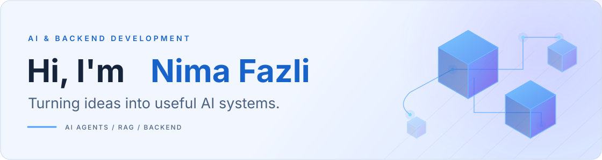
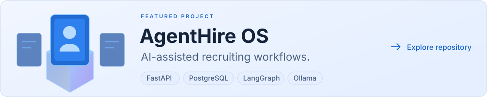
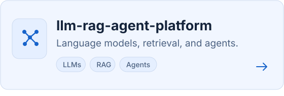

  <picture>
    <source media="(max-width: 600px) and (prefers-color-scheme: dark)" srcset="assets/hero-mobile-dark.svg">
    <source media="(max-width: 600px) and (prefers-color-scheme: light)" srcset="assets/hero-mobile-light.svg">
    <source media="(prefers-color-scheme: dark)" srcset="assets/hero-dark.svg">
    <source media="(prefers-color-scheme: light)" srcset="assets/hero-light.svg">
    
  </picture>

I build AI agents, retrieval systems, and dependable Python backends.

### Tech stack

  <picture>
    <source media="(prefers-color-scheme: dark)" srcset="assets/python-dark.svg">
    <source media="(prefers-color-scheme: light)" srcset="assets/python-light.svg">
    
  </picture>
  <picture>
    <source media="(prefers-color-scheme: dark)" srcset="assets/fastapi-dark.svg">
    <source media="(prefers-color-scheme: light)" srcset="assets/fastapi-light.svg">
    
  </picture>
  <picture>
    <source media="(prefers-color-scheme: dark)" srcset="assets/postgresql-dark.svg">
    <source media="(prefers-color-scheme: light)" srcset="assets/postgresql-light.svg">
    
  </picture>
  <picture>
    <source media="(prefers-color-scheme: dark)" srcset="assets/docker-dark.svg">
    <source media="(prefers-color-scheme: light)" srcset="assets/docker-light.svg">
    
  </picture>
  <picture>
    <source media="(prefers-color-scheme: dark)" srcset="assets/langgraph-dark.svg">
    <source media="(prefers-color-scheme: light)" srcset="assets/langgraph-light.svg">
    
  </picture>
  <picture>
    <source media="(prefers-color-scheme: dark)" srcset="assets/ollama-dark.svg">
    <source media="(prefers-color-scheme: light)" srcset="assets/ollama-light.svg">
    
  </picture>

### Selected projects

<a href="https://github.com/nima-fazli/agenthire-os">
  <picture>
    <source media="(max-width: 600px) and (prefers-color-scheme: dark)" srcset="assets/agenthire-mobile-dark.svg">
    <source media="(max-width: 600px) and (prefers-color-scheme: light)" srcset="assets/agenthire-mobile-light.svg">
    <source media="(prefers-color-scheme: dark)" srcset="assets/agenthire-dark.svg">
    <source media="(prefers-color-scheme: light)" srcset="assets/agenthire-light.svg">
    
  </picture>
</a>

<a href="https://github.com/nima-fazli/document-rag-platform">
  <picture>
    <source media="(prefers-color-scheme: dark)" srcset="assets/document-rag-dark.svg">
    <source media="(prefers-color-scheme: light)" srcset="assets/document-rag-light.svg">
    
  </picture>
</a>
<a href="https://github.com/nima-fazli/llm-rag-agent-platform">
  <picture>
    <source media="(prefers-color-scheme: dark)" srcset="assets/llm-rag-agent-dark.svg">
    <source media="(prefers-color-scheme: light)" srcset="assets/llm-rag-agent-light.svg">
    
  </picture>
</a>

What I focus on

- AI agents with scoped tools, clear evidence, and human checkpoints.
- Retrieval workflows grounded in documents.
- Python APIs with clear data boundaries and automated checks.

---

Built with curiosity. Improved through iteration.

